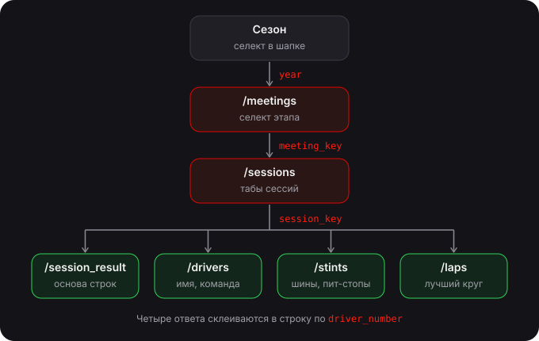
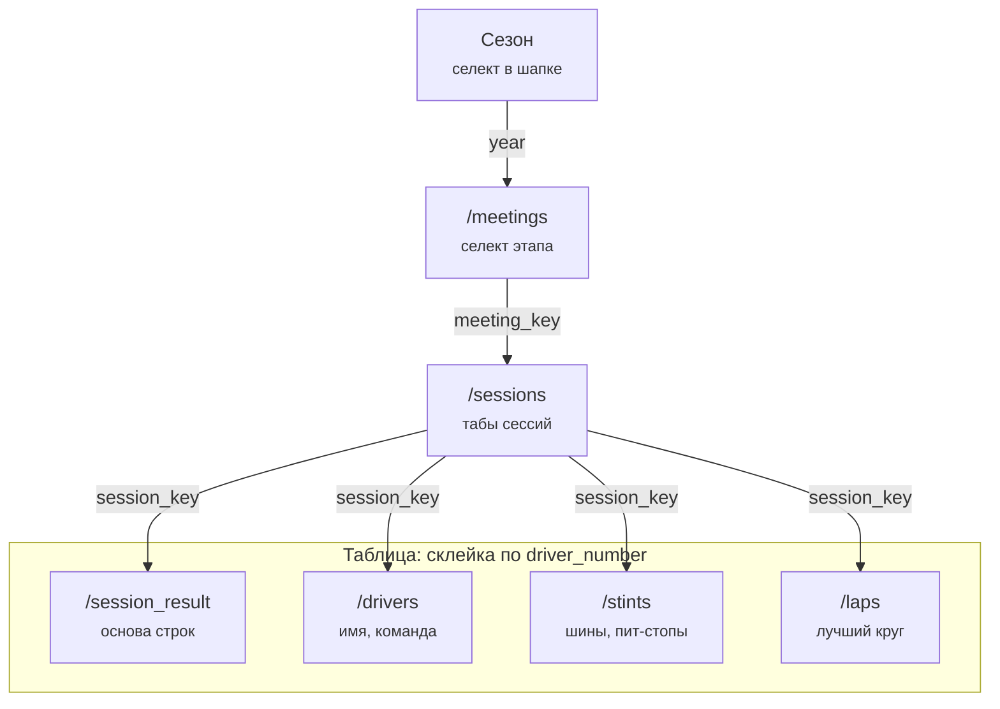

# Результаты: откуда берутся данные

Страница «Результаты» (`apps/f1/app/pages/results.vue`) собирается из шести ручек OpenF1. Каждый следующий запрос берёт ключ из того, что выбрали на предыдущем шаге.

То же в mermaid

## Выбор: сверху вниз

Поменялся верхний уровень — перезапрашивается всё, что ниже.

| Шаг | Ручка | Параметр | Что берём |
|---|---|---|---|
| Сезон | `/meetings` | `year` | `meeting_key`, `country_name`, `location`, `date_start`, `is_cancelled` |
| Этап | `/sessions` | `meeting_key` | `session_key`, `session_name`, `date_start` (порядок табов) |
| Сессия | 4 ручки таблицы | `session_key` | см. ниже |

- Номера этапа (`R17`) в API нет: сортируем этапы по `date_start` и нумеруем, тесты (`Pre-Season Testing`) выкидываем.
- Спринт-уикенд — среди сессий есть `session_name === 'Sprint'`.
- `meeting_key` и `session_key` держим в query роута, чтобы ссылкой открывались конкретные результаты.

## Таблица: четыре ручки параллельно

Запросы друг от друга не зависят — один `Promise.all`. Склеиваем по `driver_number`.

| Ручка | Колонка | Поле |
|---|---|---|
| `/session_result` | позиция, время / отставание, очки, круги | `position`, `duration`, `gap_to_leader`, `points`, `number_of_laps`, `dnf` / `dns` / `dsq` |
| `/drivers` | пилот, команда | `name_acronym`, `full_name`, `team_name`, `team_colour` |
| `/stints` | шины, пит-стопы | `compound`, `stint_number`, `tyre_age_at_start` (> 0 — б/у комплект); пит-стопов = отрезков − 1 |
| `/laps` | лучший круг | минимум `lap_duration` у пилота; минимум по всем — самый быстрый круг гонки |

## Моки

Replay-режим (`pnpm --filter @multi/f1 dev:replay`) читает `apps/f1/server/mocks/f1/<ручка>/<параметры>.json`. Записано:

- `meetings/year=2025`, `sessions/meeting_key=*` — все этапы 2025;
- таблица — все сессии Сингапура 2025 (`session_key` 9889–9892, 9896) и `latest`.
